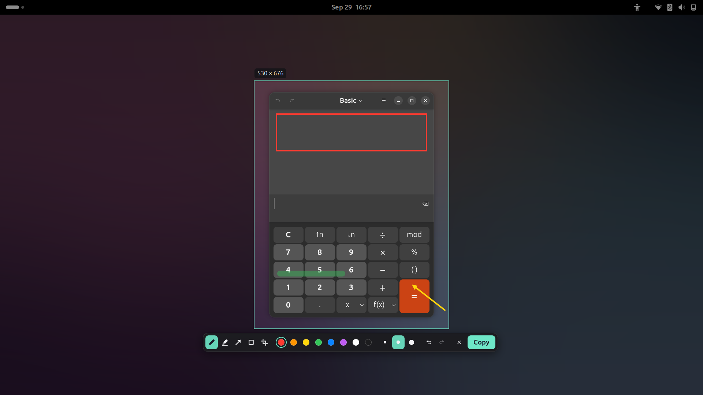
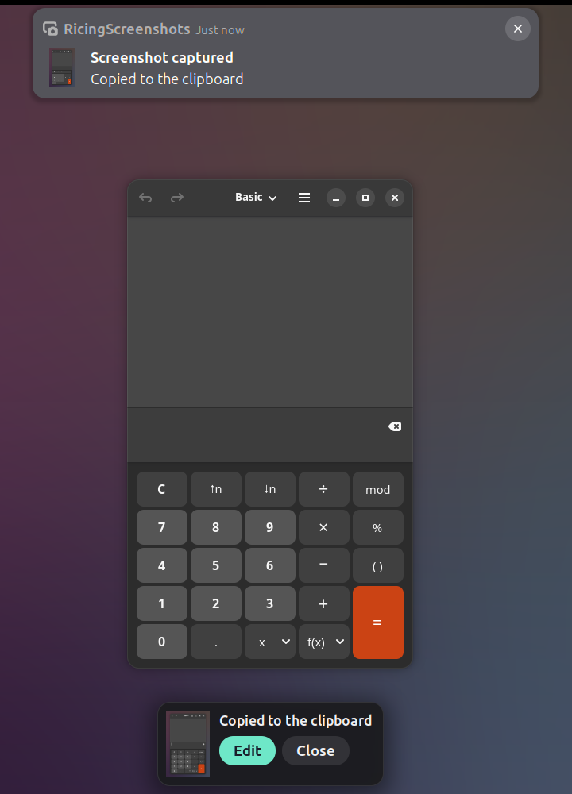

# RicingScreenshots

Area screenshots for GNOME Shell, straight to the clipboard. Press
**Print** or **Shift+Super+S**, drag over any part of the screen and the image
is copied at once. A small card then offers to edit it: draw, point with arrows, box or
highlight things, crop, and copy again. From the maker of
[RicingDock](https://github.com/hikikomoryDev/ricingdock).





## How it works

1. **Print** or **Shift+Super+S** freezes the screen. Drag over the area you want.
   Esc or a right click cancels.
2. The area is in the clipboard as soon as you let go; a notification says so.
3. A card by the area asks: **Edit** (or Enter) opens the editor, **Close**
   (or Esc, or a click anywhere else) is done.
4. In the editor, **Copy** (Enter or Ctrl+C) puts the edited picture in the
   clipboard; Esc drops the edits and keeps the original capture.

Editor keys: P pen · H highlighter · A arrow · R rectangle · C crop ·
Ctrl+Z undo · Ctrl+Shift+Z redo.

Crop by dragging the edges or corners of the frame, move it by dragging
inside, or drag a new frame outside it. Drawings stay pinned to the picture.

## Video with sound

**Super+V** records an area as video with the system sound (what you hear,
not the microphone). Pick the area as for a screenshot; a red frame marks it
and a red pill with the time sits in the top bar. **Super+V** again, or a
click on the pill, stops. A card then offers **Save to Videos** (Enter),
**Save as…** (the desktop's own save dialog) or **Discard**, and a switch to
save it **without sound** (or press M).

The video is recorded by GNOME's own screen recorder, with the sound added;
the encoder is H.264/MP4 where GStreamer has one, VP8/WebM otherwise. GNOME
opens the notification list with Super+V and Super+M; while the extension
is on, Super+M still does, and GNOME's settings are not changed.

## Settings

Out of the box RicingScreenshots borrows GNOME's screenshot key (Print) while
it is on; GNOME's own settings are never changed, and turning the
extension or the *Use the Print key* switch off gives the key back.

Also: the second shortcut, whether to offer editing, the notification, the shutter sound,
the accent color and how much the rest of the screen is darkened.

## Privacy

The extension only writes the screenshots you take to the clipboard. It
never reads the clipboard and sends nothing anywhere. Files are written only
when you save a recording.

## Install

From [extensions.gnome.org](https://extensions.gnome.org/) (search for
RicingScreenshots), or from a release zip:

```
gnome-extensions install --force ricingscreenshots@hikikomoriDev.shell-extension.zip
```

then log out and back in (GNOME on Wayland only loads new extensions at
login) and enable it in Extensions.

## Compatibility

GNOME Shell 49 and 50.

## Development

```
./install.sh --dev        # install through a loader: later runs reload in place
./pack.sh                 # build the zip for extensions.gnome.org into dist/
test/run.sh scenarios/edit.js                  # one scenario, headless GNOME 50
test/podman.sh 49 scenarios/edit.js            # the same on GNOME 49
test/suite.sh 50                               # every scenario
```

The test bench starts a real GNOME Shell without a screen, with its own
settings and no sound, drives a virtual pointer and keyboard, reads the
clipboard back and takes screenshots into `test/out/`. The GNOME 49 image is
built from RicingDock's `test/containers/`.

## Support

RicingScreenshots is free. If you like it, you can send a tip.

**Network: Solana** (SOL or any SPL token such as USDC or USDT on Solana).
Send only through the Solana network; the same tokens sent over Ethereum,
Tron, BNB Chain or any other network will be lost.

```
JG5nXAEqFaBvMttK59hN1qquNHUxJhF7AAmPYkZ8Gci
```

## License

GPL-2.0-or-later. See [LICENSE](LICENSE).
